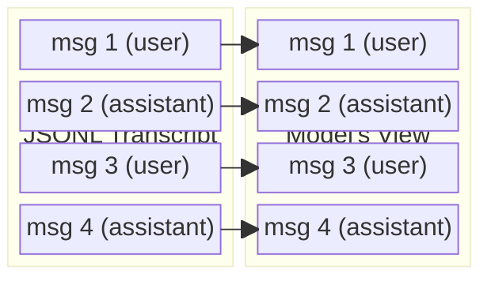
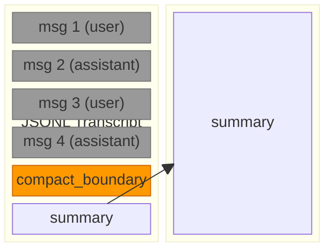
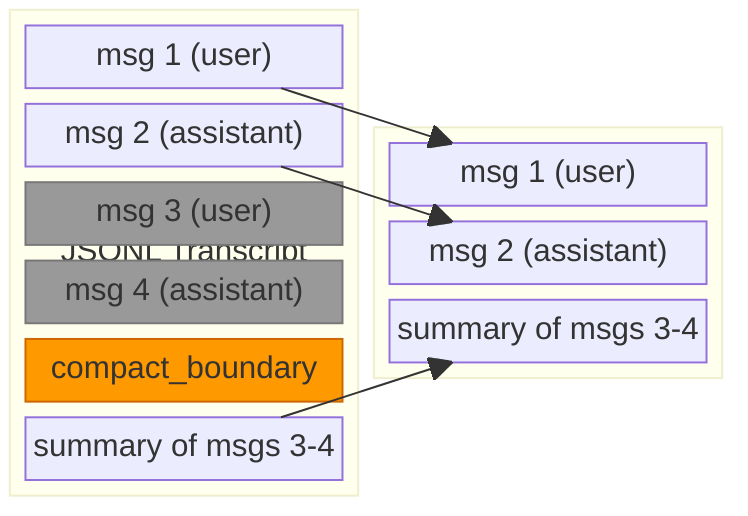
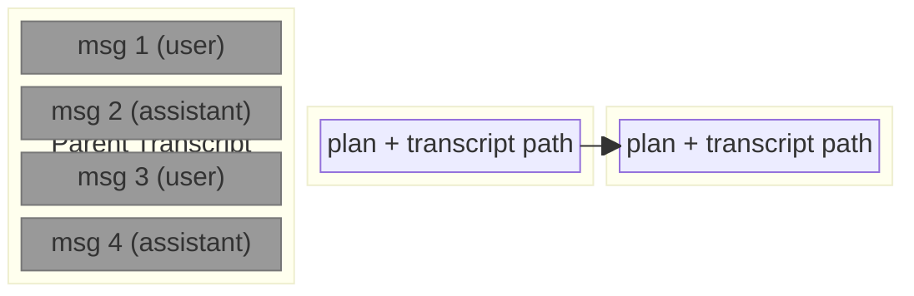
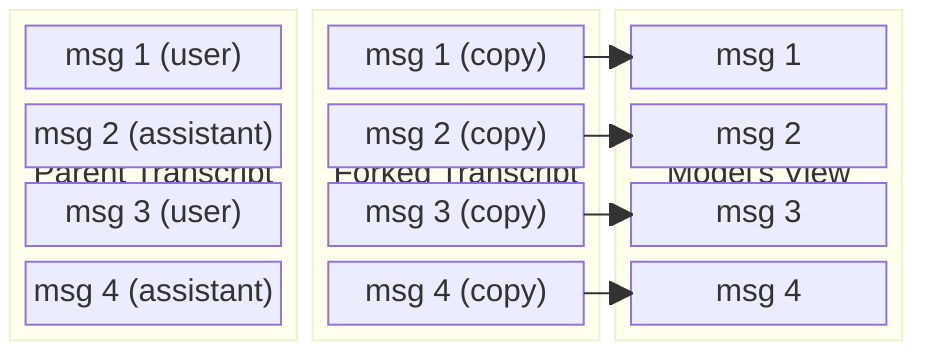

# Your Claude Code History Is Never Lost

When you run `/compact`, `/clear`, or `/fork` in Claude Code -- or select
"Summarize from here" from the message selector -- it can feel like you're
throwing away conversation history. You're not. Claude Code's transcript files
are append-only: records are added, never deleted or overwritten. Every message
you've sent and every response you've received is still on disk, even after
these operations reshape what the model sees.

This post explains what each operation actually does to the transcript, why
nothing is lost, and how to get history back when you need it.

## The transcript file

Claude Code stores each session as a JSONL file -- one JSON record per line,
appended sequentially. Each record has a UUID and points to the previous record
via `parentUuid`, forming a directed graph. The common case is a simple linear
chain, but compaction boundaries break the chain (`parentUuid: null`) and add a
`logicalParentUuid` edge pointing back to the last pre-boundary message, and
forks copy records into a new file with `forkedFrom` edges pointing back to
the original. The full structure across files is a DAG.

The model's "conversation view" is a window into this graph. It may not include
every record. Context operations change the window; they don't change the file.

The key insight: these operations only control what the model loads into
memory on the next turn. The underlying file keeps growing.

## How the diagrams work

Each diagram below shows two parallel vertical columns side by side: the JSONL
transcript file on the left and the model's conversation view on the right.
Messages stack top to bottom within each column. Arrows point from JSONL
records to the corresponding entries in the model's view, showing which records
are loaded.

Visual conventions:

- Default-colored blocks are visible to the model
- Grey blocks are still in the JSONL but hidden from the model
- Orange blocks are compaction boundary markers

## Before any operation -- the baseline

With no compaction, clear, or fork, the two columns are identical. Every
record in the JSONL file is loaded into the model's view.

Every JSONL record has a matching entry in the model's view.

## What each operation does

### `/compact` -- summarize and continue

Compaction appends two new records to the end of the file: a `compact_boundary`
marker and a summary. On the next turn, the model loads only the summary and
anything after it. All the original messages are still in the file, before the
boundary.

Messages 1-4 are greyed out because the model no longer sees them -- but they
haven't gone anywhere. They're still in the file at their original positions.
Only the summary crosses over to the model's view.

Compaction can happen multiple times. Each one adds another boundary+summary
pair. The model always loads from the last boundary forward.

### "Summarize from here" -- partial compaction

This is the selective variant. When you open the message selector (ESC ESC or
`/rewind`) and choose "Summarize from here", only the messages after your
selected point are summarized. Messages before that point remain in the model's
view alongside the new summary.

Messages 1-2 remain visible (arrows cross to the model's view). Messages 3-4
are greyed out -- summarized away but still in the file. The model sees the
kept messages plus the summary.

The `compact_boundary` record includes a `logicalParentUuid` field pointing
back to the last kept message (msg 2), and
`compactMetadata.messagesSummarized` with the count of summarized messages.
(All compaction boundaries have `logicalParentUuid` -- the
`messagesSummarized` field is what distinguishes partial from full compaction.)

### `/clear` -- start fresh with a plan

Clear context creates an entirely new transcript file. The new file's first
message contains the plan text and a path back to the parent transcript. The
parent file is left untouched -- no termination marker, no modification.

Because a new file is created, this diagram has three columns: the parent
transcript on the left, the child transcript in the middle, and the model's
view on the right.

The parent file (left, all grey) still contains every message from the
original session. The child transcript (middle) is a new, nearly empty JSONL
file whose first record contains the plan text and a file path pointing back
to the parent. The model's view (right) loads from the child. No arrows reach
back to the parent -- the only link is a text path embedded in the child's
first record.

### `/fork` -- copy and diverge

Fork creates a new transcript file containing copies of every record from the
original. Each copied record carries a `forkedFrom` field referencing the
original session and message UUID. Both files continue independently -- the
parent is unmodified.

Fork is the only operation where nothing is hidden from the model. The parent
(left) is untouched. The forked transcript (middle) contains full copies with
`forkedFrom` metadata pointing back to the parent records. The model's view
(right) loads everything from the fork. Both files continue independently.

## Nothing is destroyed

Every operation preserves the full history:

| Operation           | Where history lives            | How to find it                                       |
| :------------------ | :----------------------------- | :--------------------------------------------------- |
| `/compact`          | Same file, before the boundary | Scan records before `compact_boundary`                |
| Summarize from here | Same file, before the boundary | `messagesSummarized` + `logicalParentUuid` on boundary |
| `/clear`            | Parent file (unmodified)       | Text pointer in the child's first message             |
| `/fork`             | Both files                     | `forkedFrom` field on every copied record             |

The transcript files are structured, append-only logs. Context operations add
markers that change the model's loading behavior, but the underlying records
are immutable once written.

## Recovering history

Claude Code's model can only see what's loaded into its conversation view.
After a compaction or clear, the earlier messages are invisible to the model --
but they're not invisible to tooling.

The [history skill](https://github.com/anthropics/claude-code/wiki/history-skill)
can read and search transcript files directly, bypassing the conversation view.
When a lossy context operation has occurred -- a compaction, a clear, or a
summarize -- the history skill can look behind the boundary and retrieve the
original messages. It sees the full file, not just the window.

This means you can compact aggressively to keep your context lean, knowing that
if the model needs something from before the boundary, the history skill can
find it.

## Comparison at a glance

| Aspect              | `/compact`            | Summarize from here   | `/clear`                    | `/fork`             |
| :------------------ | :-------------------- | :-------------------- | :-------------------------- | :------------------ |
| Same file or new?   | Same                  | Same                  | New                         | New (copy)          |
| History preserved?  | Yes, in file          | Yes, in file          | Yes, parent file            | Yes, both files     |
| Model sees after    | Summary only          | Kept msgs + summary   | Plan + transcript path      | Full conversation   |
| Original continues? | Yes                   | Yes                   | No (new session)            | Yes (independent)   |
| Files affected?     | No                    | No                    | No                          | No                  |

---

# Appendix: Transcript Diagrams (Reference)

The sections below provide additional technical detail on the transcript record
types and fields involved in compaction.

## Compact-Related Records and Fields

Three record types participate in compaction.

Records:

- `compact_boundary` -- a `system` record with `subtype: "compact_boundary"`. Marks where compaction occurred. Has `parentUuid: null` (breaks the UUID chain). On resume, the loader scans for the last `compact_boundary` and only loads records after it.
- `microcompact_boundary` -- a lighter variant with `subtype: "microcompact_boundary"`. Same mechanism, smaller scope (compacts individual tool results rather than the whole conversation).
- Compaction summary -- a `user` record with `isCompactSummary: true`. Contains the summary text that replaces the compacted content in the model's view.

Fields on `compact_boundary`:

| Field                 | Description                                                                               |
| :-------------------- | :---------------------------------------------------------------------------------------- |
| `compactMetadata`     | Object containing compaction details (see sub-fields below)                               |
| `.trigger`            | `"auto"` (context limit) or `"manual"` (user invoked /compact or Summarize from here)    |
| `.preTokens`          | Token count before compaction                                                             |
| `.userContext`        | Optional text the user provided (only for "Summarize from here")                          |
| `.messagesSummarized` | Count of summarized messages (only for "Summarize from here")                             |
| `logicalParentUuid`   | UUID of the last message before the boundary. Present on all compaction types             |

Fields on the compaction summary record:

| Field                 | Description                                                             |
| :-------------------- | :---------------------------------------------------------------------- |
| `isCompactSummary`    | Boolean, always `true`                                                  |
| `summarizeMetadata`   | Object, only present for partial compaction ("Summarize from here")     |
| `.messagesSummarized` | Count of summarized messages                                            |
| `.userContext`        | Optional user-provided context text                                     |
