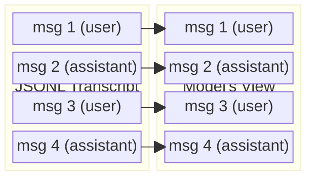
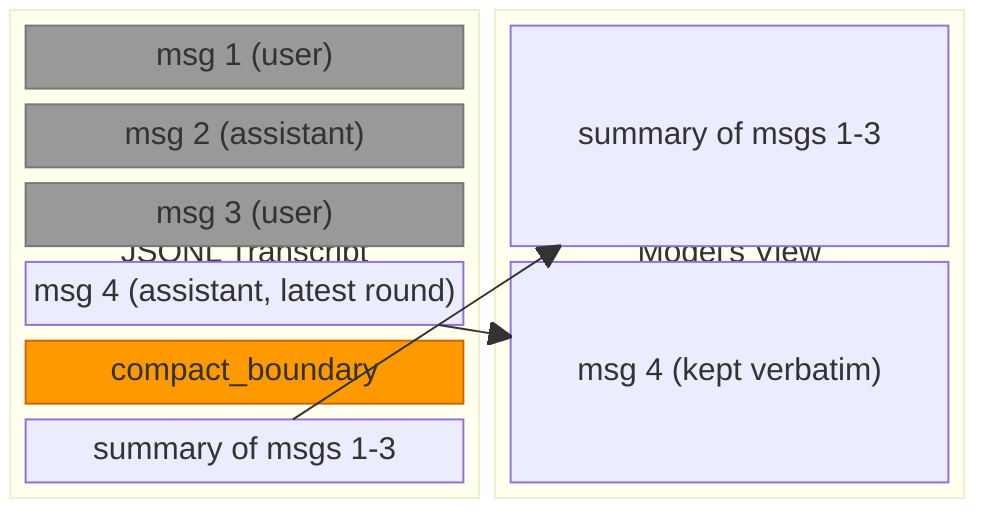
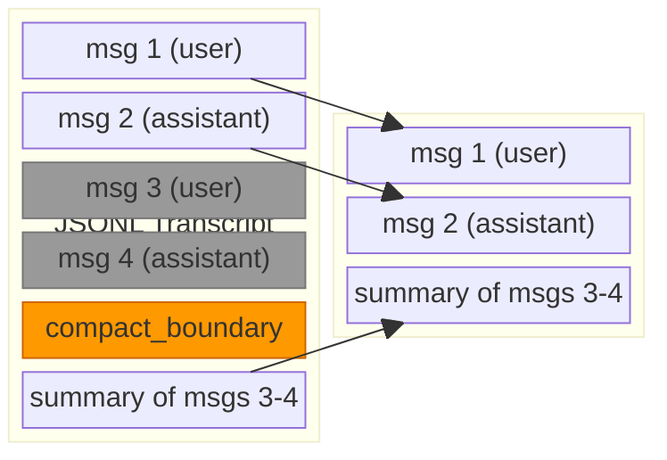
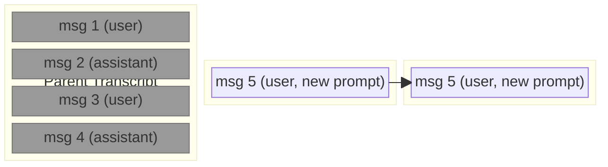
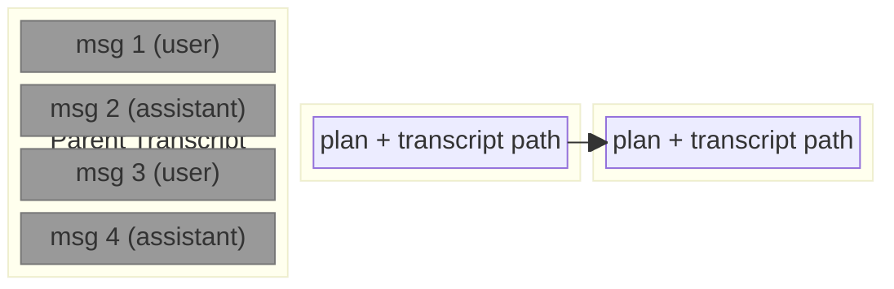
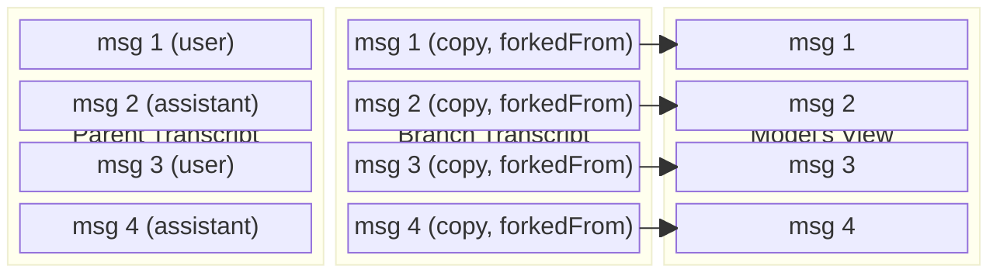
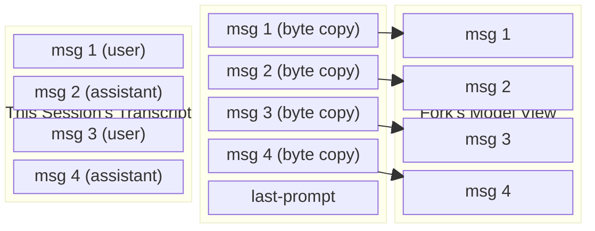
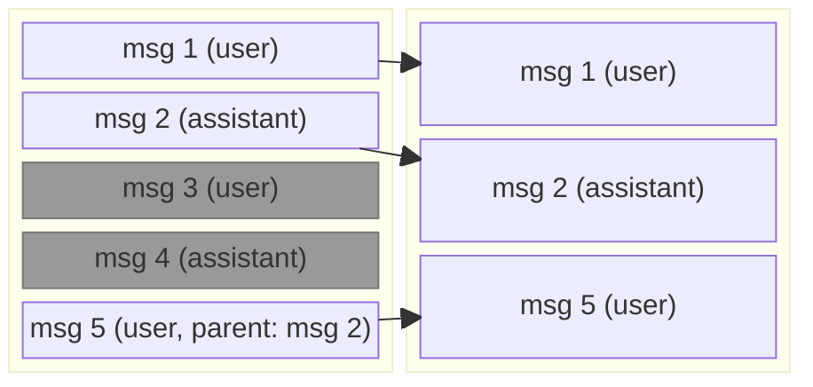

# Context Operations in Diagrams: What Stays in the Transcript

When you run `/compact`, `/clear`, `/branch`, `/fork` or `/rewind` in Claude Code, or select
"Summarize from here" in the message selector, it can feel like you're throwing away conversation
history. Mostly you're not. Claude Code's transcript files are append-only logs: these operations
add records or start new files, and the earlier messages stay on disk even after they reshape what
the model sees.

This page shows what each operation does to the transcript, where the history goes, and how to get
it back. The full mechanics, with relocation recipes, are in `CLEAR_COMPACT_FORK_CONTEXT.md`; the
record format is in `SESSION_TRANSCRIPT.md`.

## The transcript file

Claude Code stores each session as a JSONL file: one JSON record per line, appended in order. The
file is created when the first user, assistant or system message is written, not when the session
starts. Each conversation record has a `uuid` and points at the record before it through
`parentUuid` (a tool result points at the assistant message that made the call). Metadata records
such as `custom-title`, `last-prompt` and `tools-used` carry no `uuid` and are not in the chain.

The common case is a linear chain, with three ways to depart from it:

- A `compact_boundary` record is written with `parentUuid: null`, breaking the chain, and a
  `logicalParentUuid` pointing back to the last message before it (envelope writer:
  `rg -n 'tengu_chain_self_reference_write'`, beside `parentUuid` set to null for a boundary).
- A rewind records the last kept message as the session's leaf, and the next message's `parentUuid`
  names it, so the abandoned messages become a side branch that the loader no longer follows.
- `/branch` copies records into a new file, each carrying a `forkedFrom` edge back to the original
  session and message.

Across files the structure is a DAG. The model's view is a window into it, rebuilt by walking the
chain back from the session's leaf (the newest message, or the leaf a rewind recorded) and cut at
the last `compact_boundary`. Context operations change the window; the file keeps growing.

Three things do remove history from disk:

- Retention cleanup deletes transcripts older than `cleanupPeriodDays` (default 30, minimum 1;
  `rg -n 'Days to keep transcripts before automatic cleanup'`). Transcripts written by Claude
  Desktop or Cowork are exempt from that sweep; `desktopSessionCleanupPeriodDays` can bound them,
  and its default of 0 sets no limit.
- When a streaming or refusal fallback supersedes a message already written, the record is cut out
  of the file in place (`rg -n 'Skipping tombstone removal'`; event
  `tengu_tombstone_persisted_removal`). The superseded message is a partial response, not
  conversation history the model saw.
- With `CLAUDE_CODE_TRANSCRIPT_LOCAL_GC` in a non-interactive (`-p`) or remote-worker session, the
  file is rewritten after a compaction to drop the records the loader would skip
  (`rg -n 'CLAUDE_CODE_TRANSCRIPT_LOCAL_GC'`). Interactive sessions never enable it.

## How the diagrams work

Each diagram shows parallel vertical columns: the JSONL transcript file (or files) on the left and
the model's conversation view on the right. Messages stack top to bottom within each column. Arrows
point from JSONL records to the entries they become in the model's view.

Visual conventions:

- Default-colored blocks are visible to the model
- Grey blocks are still in the JSONL but hidden from the model
- Orange blocks are compaction boundary markers

## Before any operation -- the baseline

With no compaction, clear, branch, fork or rewind, the two columns are identical. Every conversation
record in the JSONL file is loaded into the model's view.

Every JSONL record has a matching entry in the model's view.

## What each operation does

### `/compact` -- summarize and continue

Compaction appends two records to the end of the file: a `compact_boundary` marker
(`rg -n 'content: "Conversation compacted"'`) and a `user` summary record with
`isCompactSummary: true`. `/compact` and most auto-compactions run the round-grouped engine: it
splits the conversation into API rounds (a new round starts at each new assistant message id),
summarizes all but the most recent round, and keeps that round verbatim. Afterwards the model sees
the summary followed by the kept round. The kept messages are not copied: they stay where they were,
and the boundary's `compactMetadata.preservedSegment` (or `preservedMessages`) names them so a
resumed session restores them.

Messages 1-3 are greyed out because the model no longer sees them, but they are still in the file at
their original positions. Message 4, the latest round, crosses over unchanged after the summary.

The whole-conversation engine, which auto-compaction uses when the round-grouped engine is
unavailable and for in-process teammates, keeps nothing: the model's view is the summary alone.

Compaction can happen many times. Each one adds another boundary and summary pair, and the model's
view always starts at the last boundary.

Microcompact is not a compaction in this sense. It replaces the content of older tool results with
`[Old tool result content cleared]` in what the model is sent, keeping the most recent ones
(`rg -n 'Old tool result content cleared'`). It writes no boundary record, and the original tool
results stay in the JSONL. The `microcompact_boundary` subtype is still recognized when reading a
transcript, but nothing writes it.

### "Summarize from here" -- partial compaction

This is the selective variant. Open the message selector (Esc Esc or `/rewind`), select a message,
and choose "Summarize from here": the selected message and everything after it are summarized, and
the messages before it stay in the model's view alongside the summary. The option appears only when
file checkpointing is on (otherwise selecting a message restores the conversation at once) and is
hidden when `DISABLE_COMPACT` is set (`rg -n '"tengu_partial_compact"'`).

Messages 1-2 remain visible. Messages 3-4 are greyed out: summarized away but still in the file. The
model sees the kept messages followed by the summary.

The `compact_boundary` has `logicalParentUuid` pointing at the last kept message (msg 2),
`compactMetadata.messagesSummarized` with the count of summarized messages, `userContext` with the
optional text typed into the selector, and `preservedSegment` naming the kept messages. Every
boundary has `logicalParentUuid`; `messagesSummarized` is what distinguishes partial from full
compaction.

"Summarize up to here" is the mirror image: the messages before the selected one are summarized, and
the selected message and everything after it are kept, after the summary. Its `logicalParentUuid` is
the last message before the selected one.

### `/clear` -- start a new session

`/clear` (`rg -n 'Start a new session with empty context'`; aliases `/reset` and `/new`) ends the
session and starts a new one with a new session ID and empty context. The new session writes its own
JSONL file once its first message is recorded. The parent file gets no termination marker; the only
record `/clear` can add to it is a `custom-title`, when you run `/clear <name>`.

Because a new file is created, this diagram has three columns: the parent transcript on the left,
the child transcript in the middle, and the model's view on the right.

The parent file (left, all grey) still holds every message of the original session and stays
resumable with `/resume`. Nothing on disk links the child to it: the parent session ID is kept only
in memory (and in telemetry), and in the same process the `/rewind` selector offers a
`/resume <id> (previous session)` row.

Approving a plan with a clear-context option (offered only when `showClearContextOnPlanAccept` is
`true`) runs the same reset, but the child's first message carries the plan and a path back to the
parent (`rg -n 'If you need specific details from before exiting plan mode'`):

The child's first prompt starts `Implement the following plan:` and ends
`read the full transcript at: <parent session JSONL path>`. No arrows reach back to the parent: the
only link is that text path.

### `/branch` -- copy the conversation and switch to the copy

`/branch` (`rg -n 'Create a branch of the current conversation'`) writes a new transcript file
holding copies of the conversation records the session currently has in memory, so after a
compaction it copies only what the model sees, not the records before the boundary. Each copy gets
the new session ID, a re-linked `parentUuid`, and a `forkedFrom` field naming the original session
and message UUID. The session then switches to the branch (`rg -n 'You are now in the new branch'`).
The original file is not modified and stays resumable with `/resume`.

The parent (left) is untouched. The branch (middle) contains copies with `forkedFrom` pointing back
to the parent records. The model's view (right) now loads from the branch, and the parent is no
longer written to unless you resume it.

### `/fork` -- copy the conversation into a background session

With the agent view enabled (the default), `/fork`
(`rg -n 'Copy this conversation into a new background session'`) copies the current transcript file
byte for byte under a new session ID, appends a `last-prompt` record pinning the fork point, and
launches a background session that resumes the copy. The current session keeps working in its own
file, unchanged. The copy is not rewritten record by record, so it carries no `forkedFrom` field.
With the agent view disabled, `/fork` is instead a background agent that inherits the conversation.

The original session (left) carries on with its view unchanged. The fork transcript (middle) is an
exact copy plus a `last-prompt` trailer; when the original works in the same checkout or a linked
worktree, a `fork_briefing` record telling the fork to use its own worktree is appended too. The
fork's model view (right) is what resuming the copy rebuilds, so if the original had been compacted,
it starts at the last boundary just as the original's does.

### `/rewind` -- restore the conversation to an earlier message

`/rewind` (Esc Esc) opens the message selector. "Restore conversation" truncates the in-memory
conversation to the messages before the selected one and puts the selected prompt back in the input
(`rg -n 'tengu_conversation_rewind'`). Nothing is removed from the file. The rewind appends one
`last-prompt` record with `leafUuid` set to the last kept message, `explicit: true` and
`rewound: true` (writer: `rg -n 'rewind persist-failure remote heal failed'`), so a session resumed
before the next prompt still starts from the rewound point. A rewind to before the first message
writes a null `leafUuid`.

Rewinding to msg 3 leaves msgs 3-4 in the file (the diagram omits the `last-prompt` record, which
the model never sees). The next prompt, msg 5, is appended with `parentUuid` naming msg 2, so msgs
3-4 become a dead branch of the chain: still on disk, no longer on the path the model's view is
rebuilt from. "Restore code" rewinds files to the checkpoint instead, and touches no transcript
record.

## Where the history goes

| Operation           | Where history lives            | How to find it                            |
| :------------------ | :----------------------------- | :---------------------------------------- |
| `/compact`          | Same file, before the boundary | Records before the last boundary          |
| Summarize from here | Same file, before the boundary | `messagesSummarized`, `logicalParentUuid` |
| `/clear`            | Parent file                    | Plan approval: path in the first prompt   |
| `/branch`           | Parent file (unmodified)       | `forkedFrom` on every copied record       |
| `/fork`             | Original file, continuing      | Byte copy of the original's records       |
| `/rewind`           | Same file, on a dead branch    | `last-prompt` with `rewound: true`        |

A plain `/clear` leaves no link on disk: find the parent by session time, or scan sibling JSONL
files. The same goes for a parent of `/branch` looking for its branches: scan siblings for a
matching `forkedFrom.sessionId`.

The transcript files are structured, append-only logs. Context operations add markers that change
what the model loads, but the records already written stay as they are, apart from the removals
listed under "The transcript file".

## Recovering history

The model can only see what's loaded into its conversation view. After a compaction, clear or
rewind, the earlier messages are invisible to the model, but not to tooling that reads the JSONL
directly. Such a tool can look behind a boundary or down a dead branch and retrieve the original
messages, because it sees the whole file rather than the window.

The summary itself points the way: after a compaction it ends `read the full transcript at: <path>`
when a transcript path is available, and the plan-approval clear does the same. That lets the model
read the file itself when it needs something from before the boundary.

## Comparison at a glance

| Operation           | File            | Model sees afterwards            | Original continues?   |
| :------------------ | :-------------- | :------------------------------- | :-------------------- |
| `/compact`          | Same            | Summary + latest round           | Yes (same session)    |
| Summarize from here | Same            | Kept messages + summary          | Yes (same session)    |
| `/clear`            | New             | Empty, or plan + transcript path | No (new session)      |
| `/branch`           | New (copy)      | In-memory conversation (copy)    | Not active; resumable |
| `/fork`             | New (byte copy) | Original unchanged; fork: copy   | Yes (fork runs apart) |
| `/rewind`           | Same            | Messages before the selected one | Yes (same session)    |

None of these operations change your project files, except `/rewind` when you choose to restore
code.

---

# Appendix: Compaction Records and Fields

The record types and fields involved in compaction.

Records:

- `compact_boundary`: a `system` record with `subtype: "compact_boundary"` and
  `content: "Conversation compacted"`. Its `parentUuid` is `null` (breaking the chain) and its
  `logicalParentUuid` names the last message before it. On resume the loader starts at the last
  `compact_boundary`, then restores the kept messages its `preservedSegment` or `preservedMessages`
  names.
- Compaction summary: a `user` record with `isCompactSummary: true`, holding the summary text that
  replaces the compacted content in the model's view.
- `microcompact_boundary`: recognized when reading a transcript, never written.

Fields on `compact_boundary`:

| Field                 | Description                                                              |
| :-------------------- | :----------------------------------------------------------------------- |
| `compactMetadata`     | Object containing compaction details (sub-fields below)                  |
| `.trigger`            | `"auto"` (threshold, prompt-too-long, idle) or `"manual"`                |
| `.preTokens`          | Token count before compaction                                            |
| `.userContext`        | Optional text typed into the selector (partial compaction only)          |
| `.messagesSummarized` | Count of summarized messages (partial compaction only)                   |
| `.preservedSegment`   | `headUuid`, `anchorUuid`, `tailUuid` of the messages kept verbatim       |
| `.preservedMessages`  | Explicit list of kept messages, the alternative to `preservedSegment`    |
| `.postTokens`, others | Also `durationMs`, `precomputed`, `preCompactDiscoveredTools`            |
| `logicalParentUuid`   | UUID of the last message before the boundary; present on all compactions |

`"manual"` covers `/compact`, "Summarize from here" and "Summarize up to here". `userContext` and
`messagesSummarized` are undefined on a full compaction, so the keys are absent from the JSON.

Fields on the compaction summary record:

| Field                 | Description                                                        |
| :-------------------- | :----------------------------------------------------------------- |
| `isCompactSummary`    | Boolean, always `true`                                             |
| `summarizeMetadata`   | Object, partial compaction only, present when any message was kept |
| `.messagesSummarized` | Count of summarized messages                                       |
| `.userContext`        | Optional user-provided context text                                |
| `.direction`          | `"from"` (Summarize from here) or `"up_to"` (Summarize up to here) |
